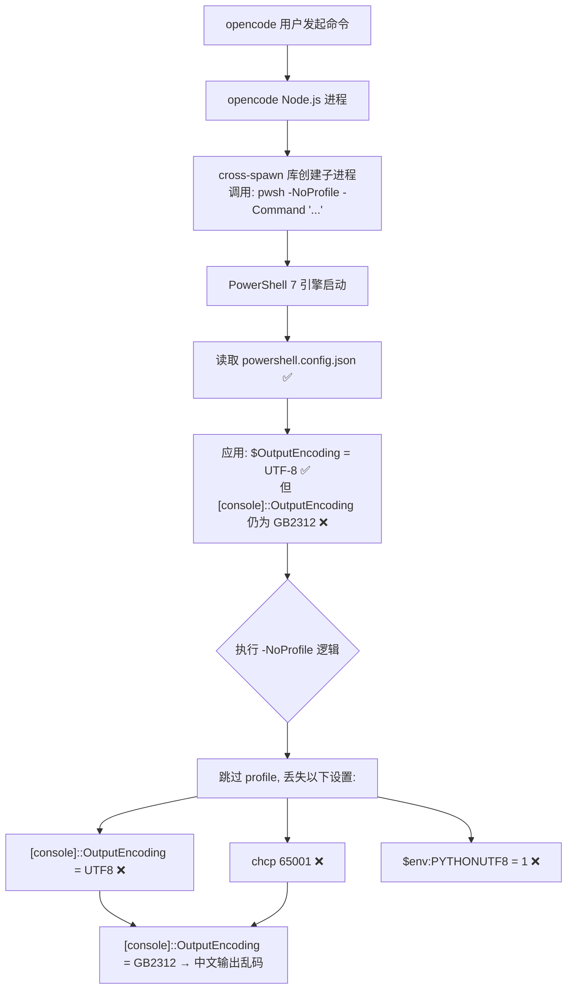
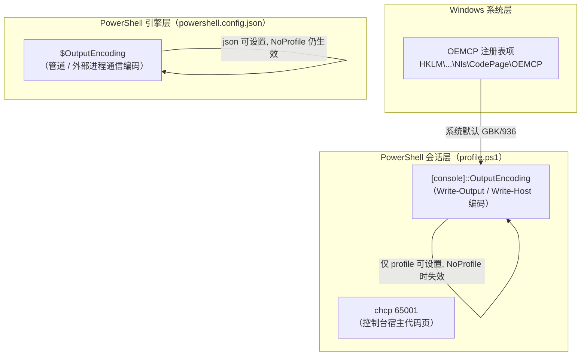
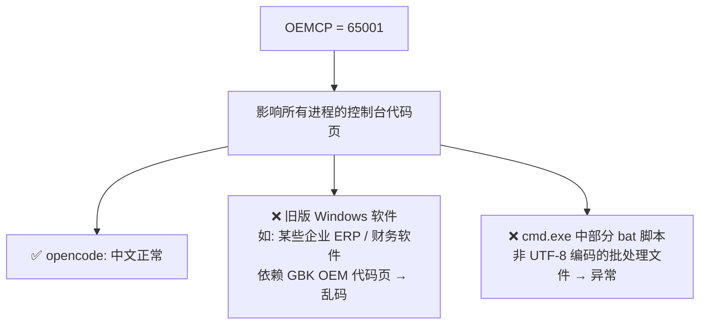
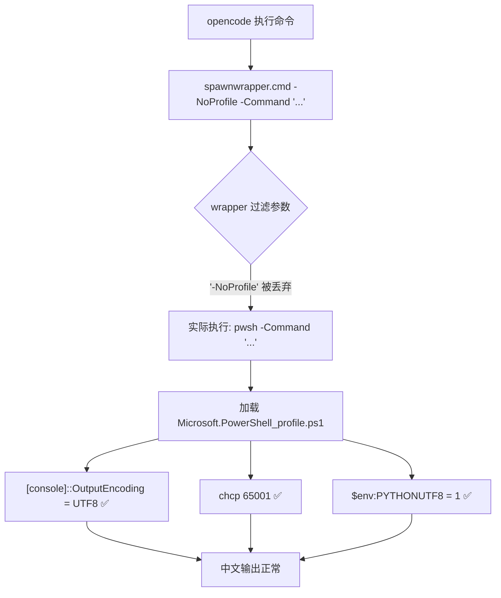
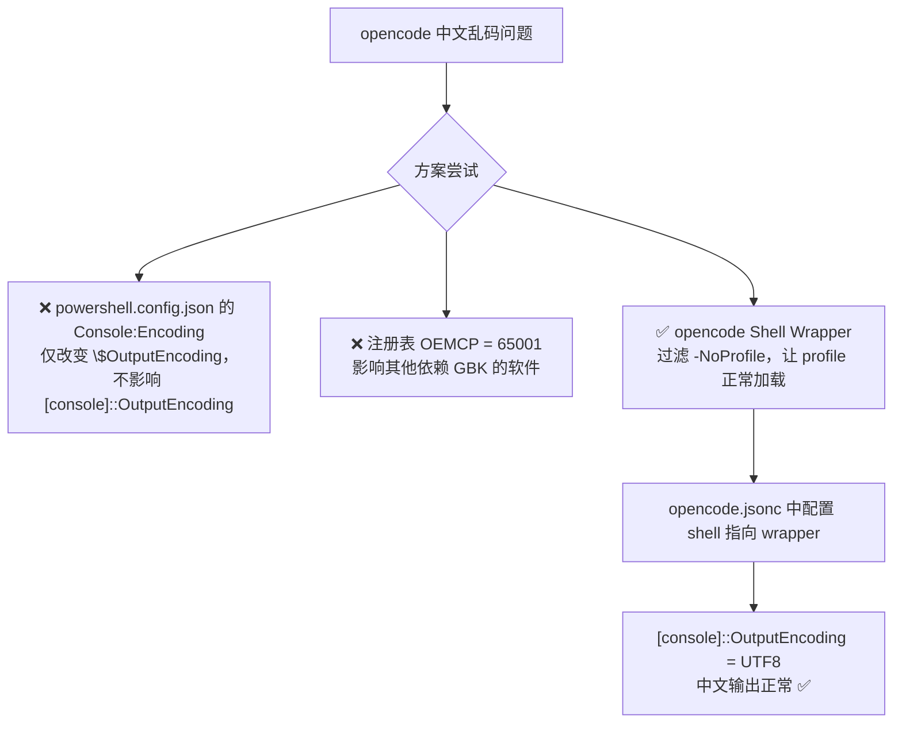

# opencode 中 PowerShell 命令输出中文乱码：排查与解决方案

> 日期：2026-08
> 类型：环境问题排查记录
> 关联：本排查记录是 ShellFix 插件「中文不乱码」功能的背景研究，插件实现见 [README → ① 中文不乱码](../README.md) 的「解决思路对比」小节

---

## 执行摘要

opencode 底层用 `cross-spawn` 固定以 `pwsh -NoProfile` 启动子进程，跳过 profile，使 `[console]::OutputEncoding` 停留在 GB2312 从而中文乱码。三种方案对比后：

| 方案 | 结论 |
|------|------|
| `powershell.config.json` | ❌ 只能改 `$OutputEncoding`，够不到 `[console]::OutputEncoding` |
| 注册表 `OEMCP=65001` | ❌ 全局波及依赖 GBK 的旧软件 |
| **CMD Wrapper**（最终采用） | ✅ 过滤 `-NoProfile`，让 profile 正常加载 UTF-8 设置 |

最终方案：用一个过滤掉 `-NoProfile` 的 CMD wrapper 作为 opencode 的 shell 配置项，让 profile 正常加载 UTF-8 设置。

---

## 一、问题现象

在 opencode 中执行 PowerShell 命令时，中文输出显示为乱码（如 `????` 或 `锟斤拷`），但在 Windows Terminal 中直接运行相同命令则正常显示。

---

## 二、根因分析

### 2.1 问题链路



### 2.2 关键节点

opencode 底层使用 `cross-spawn` 库创建 PowerShell 子进程，启动参数中固定携带 `-NoProfile`：

- **目的**：避免用户 profile 中的不确定因素干扰 opencode 的行为，确保命令执行环境干净、可预测
- **副作用**：profile 中设置的 `[console]::OutputEncoding = UTF8` 被跳过，该属性保持为系统默认的 GB2312，导致所有中文输出乱码

### 2.3 层级编码体系



`[console]::OutputEncoding` 是 `Write-Output` 等命令输出中文时最直接相关的编码设置，但它**只能通过 profile 脚本设置**，`powershell.config.json` 无法影响它。

### 2.4 powershell.config.json 的能力边界（实测）

| 测试场景 | `[console]::OutputEncoding` | `$OutputEncoding` | 中文输出 |
|----------|----------------------------|-------------------|----------|
| `pwsh`（正常启动） | Unicode (UTF-8) | Unicode (UTF-8) | ✅ 正常 |
| `pwsh -NoProfile` | Chinese Simplified (GB2312) | Unicode (UTF-8) | ❌ 乱码 |

> 即使 `powershell.config.json` 中已配置 `"Microsoft.PowerShell.Console:Encoding": "utf-8"`，`-NoProfile` 下 `[console]::OutputEncoding` 仍为 GB2312，**单独靠 json 配置无法解决问题**。

---

## 三、为什么不推荐修改注册表 OEMCP

### 3.1 尝试过的方案

```powershell
reg add "HKEY_LOCAL_MACHINE\SYSTEM\CurrentControlSet\Control\Nls\CodePage" /v OEMCP /t REG_SZ /d 65001 /f
```

此命令将系统全局 OEM 代码页从 936（GBK）改为 65001（UTF-8）。

### 3.2 副作用



OEMCP 是系统级全局设置，修改后**所有进程**的控制台代码页都会变为 UTF-8，部分依赖 GBK 编码的传统 Win32 软件会因此出现界面乱码或功能异常。

### 3.3 方案对比

| 方案 | 影响范围 | 副作用 | 能否解决 `-NoProfile` 问题 |
|------|----------|--------|----------------------------|
| 修改注册表 `OEMCP=65001` | 全局，所有进程 | 旧软件 GBK 乱码 | ✅ |
| 修改 `powershell.config.json` | 仅 PowerShell 7 | 无副作用 | ❌（不够，`[console]::OutputEncoding` 不变） |
| profile 中 `chcp 65001` | 仅当前控制台会话 | 无副作用 | ❌（`-NoProfile` 时失效） |
| **opencode Shell Wrapper** | 仅 opencode 内的 shell | 无副作用 | ✅ |

---

## 四、最终解决方案：opencode Shell Wrapper

### 4.1 整体架构



### 4.2 第 1 步：创建 CMD Wrapper

`D:\Documents\PowerShell\Scripts\opencode-shell.cmd`（使用 `%*` 字符串替换，避免特殊字符/空格被 CMD 拆分）：

```cmd
@echo off
set "ARGS=%*"
set "ARGS=%ARGS:-NoProfile =%"
set "ARGS=%ARGS: -NoProfile=%"
pwsh.exe %ARGS%
```

**为什么弃用 `%1` + `shift` 逐参数解析（v1 → v2）**

早期 v1 版本用 `%1` / `shift` / `goto` 循环逐个过滤参数，存在致命缺陷：当参数或文件名含空格时，CMD 会在引号内空格处拆参异常。例如执行 `obsidian move path="PowerShell 代理设置…"` 会被断开，报「命令的语法不正确」。

v2 改用 `%*` 一次性取回全部参数做字符串替换（把 `-NoProfile` 替换为空），完全不参与 CMD 的逐 token 解析，彻底解决空格与特殊字符的兼容问题。两条 `set` 分别处理两种位置：

- `-NoProfile` 在中间：`-NoProfile` 带尾空格
- `-NoProfile` 在末尾：` -NoProfile` 带前空格

### 4.3 第 2 步：配置 opencode 使用 Wrapper

修改 `~/.config/opencode/opencode.jsonc`，添加 `shell` 配置项：

```jsonc
{
  "$schema": "https://opencode.ai/config.json",
  "shell": "D:\\Documents\\PowerShell\\Scripts\\opencode-shell.cmd",
  "plugin": [
    "@mohak34/opencode-notifier@latest",
    "opencode-beautiful-mermaid@latest"
  ]
}
```

`shell` 配置项告诉 opencode 使用指定的可执行文件作为 Shell。opencode 会将所有参数（包括 `-NoProfile`）传给该文件，由 wrapper 负责过滤。

### 4.4 第 3 步：重启 opencode 并验证

重启后在 opencode 中执行：

```powershell
Write-Output "中文测试：你好世界，开工了"
```

预期输出：

```
中文测试：你好世界，开工了
```

---

## 五、补充：opencode 中运行 Python 脚本

### 5.1 问题

profile 中的 `$env:PYTHONUTF8 = 1` 在 wrapper 方案下已随 profile 加载自动生效，无需额外配置。

### 5.2 如果因其他原因需要在非 profile 环境下生效

可将 `PYTHONUTF8` 设为**用户环境变量**（Windows 系统设置 → 环境变量），用户环境变量会被所有子进程继承，包括 `-NoProfile` 启动的 PowerShell。

---

## 六、总结



### 操作步骤清单

| 步骤 | 操作 | 文件 |
|------|------|------|
| 1 | 创建 CMD wrapper，过滤 `-NoProfile` 参数 | `Scripts/opencode-shell.cmd` |
| 2 | 在 opencode 配置中指定 wrapper 为 shell | `~/.config/opencode/opencode.jsonc` |
| 3 | 保留 `powershell.config.json` 的 `Console:Encoding`（作为辅助保底） | `powershell.config.json` |
| 4 | 重启 opencode 生效 | — |

---

## 附：与 ShellFix 插件的关系

本排查记录解决的是**环境级**问题（修改 opencode 的 shell 启动方式，让 profile 生效，属用户自行配置）。

而 ShellFix 插件本身应对乱码的方式是在**每条命令前注入** UTF-8 编码设置：

```powershell
$OutputEncoding=[Console]::OutputEncoding=[Console]::InputEncoding=[Text.Encoding]::UTF8;
```

两条路线互补：

| 路线 | 生效范围 | 是否需要 profile | 适合场景 |
|------|----------|------------------|----------|
| ShellFix 命令前缀注入 | 仅 ShellFix 处理的命令 | 否（`-NoProfile` 下也生效） | 使用 ShellFix 插件的用户 |
| CMD Wrapper（本文） | opencode 内所有 shell 命令 | 是（依赖 profile 加载） | 未使用 ShellFix，或需 profile 函数/别名/环境变量的用户 |

若已使用 ShellFix 插件，编码问题已被前缀注入解决，通常无需再配置 CMD Wrapper；若还需 profile 中的自定义函数、别名等能力，则两者可叠加使用。